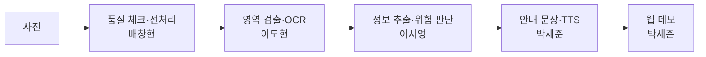

# 패키지 읽어주기 (AI_tts_web)

시각장애인을 위한 식품 포장 인식 시스템. 포장 사진에서 글자를 읽고, 소비기한과 알레르기 성분을 골라 **위험한 정보부터** 음성으로 알려 준다.

2026년 2학기 딥러닝 Team05

[](https://colab.research.google.com/github/DL-2026F-Team05/AI_tts_web/blob/main/notebooks/00_setup_and_demo.ipynb)

## 흐름



모든 단계는 결과 형식 하나(`packreader/schema.py`의 `AnalysisResult`)를 채워서 넘긴다. 약속은 [docs/interface.md](docs/interface.md).

## 폴더와 담당

| 폴더 | 내용 | 담당 |
|---|---|---|
| `packreader/preprocess/` | 품질 체크(흐림·어두움·반사), 보정 | 배창현 |
| `packreader/ocr/` | 영역 검출, OCR 엔진 (가짜·EasyOCR·PaddleOCR) | 이도현 |
| `packreader/extract/` | 제품명·소비기한·알레르기 추출, 위험 판단 | 이서영 |
| `packreader/speech/` | 안내 문장, 숫자 읽기, TTS 엔진 | 박세준 |
| `packreader/pipeline.py` | 전체 연결 | 박세준 |
| `app/` | 웹 데모 (FastAPI + 접근성 화면) | 박세준 |
| `evaluation/` | 지표 계산, 평가 실행 | 공통 |
| `tools/` | 데이터 규칙 검사, 제품 단위 분할, 샘플 생성 | 공통 |
| `tests/` | 단위·통합 테스트 | 박세준 (각 모듈 테스트는 담당자) |
| `docs/` | 계획, 인터페이스, 데이터·평가·코랩 안내 | 공통 |
| 보고서 / PPT / 발표 | | 박주윤 / 백연경 / 김세희 |

## 빠르게 실행

### 코랩
위 배지로 `notebooks/00_setup_and_demo.ipynb`를 열고 위에서부터 실행한다. 자세한 건 [docs/colab_guide.md](docs/colab_guide.md).

### 내 컴퓨터
윈도우는 `run_local.bat` 더블클릭: 가상환경 만들기 → 설치 → 테스트 → 웹 데모까지 한 번에 하고 브라우저를 연다.

직접 하려면:
```bash
pip install -r requirements.txt -r requirements-dev.txt
python -m pytest -q                       # 테스트
uvicorn app.main:app --port 8000          # 웹 데모 → http://localhost:8000
```

```python
from packreader.pipeline import Pipeline
print(Pipeline().analyze("data/samples/S001.jpg").speech.summary)
```

엔진은 환경 변수로 바꾼다.

| 변수 | 값 | 기본 |
|---|---|---|
| `PACK_OCR` | `dummy`, `easyocr`, `paddle` | `dummy` |
| `PACK_DETECTOR` / `PACK_DETECTOR_WEIGHTS` | `none`, `yolo` / 가중치 경로 | `none` |
| `PACK_TTS` | 쉼표로 순서: `melo,edge,gtts,mms`, `none` | `melo,edge,gtts` |

## 지금 들어 있는 것

| 모듈 | 들어 있는 것 | 다음 할 일 |
|---|---|---|
| 전처리 | 선명도·밝기·반사 판정, 어두울 때 CLAHE | 실제 데이터로 기준값 조정, 보정 방법 추가 |
| OCR | 가짜 OCR(합성 샘플 정답), EasyOCR·PaddleOCR 래퍼, YOLO 검출기 자리 | 기준 성능 측정, 영역 검출 학습, 파인튜닝 |
| 추출 | 날짜 4가지 형식, 표시 대상 19종 사전, 함유/혼입 구분, 판단 보류 | `tests/test_extract_spec.py`의 xfail 항목 |
| 안내·TTS | 위험 우선 문장, 숫자·단위 읽기, 엔진 순서 시도·캐시, 브라우저 음성 대체 | 코랩에서 엔진 비교 실험, 사용자 테스트 |
| 웹 데모 | 촬영·업로드, 샘플, 알레르기 등록, 다시 듣기·더 듣기, 스크린리더 모드, 개발자 보기 | 실제 엔진 연결 후 폰 시연 |
| 평가 | CER·WER·검출 F1·항목별 F1·위험 놓침률·보류율·조건별 표 | 테스트셋 라벨이 모이면 실행 |

`data/samples/`의 사진 6장은 지어낸 제품으로 만든 합성 샘플이다. 모델 없이도 사진에서 음성까지 한 바퀴를 확인하는 데 쓴다.

## 문서

- [docs/plan.md](docs/plan.md): 역할, 주차별 일정, 산출물
- [docs/interface.md](docs/interface.md): 모듈끼리 주고받는 형식
- [docs/data_guide.md](docs/data_guide.md): 촬영 규칙, 파일 이름, 정답표
- [docs/eval_protocol.md](docs/eval_protocol.md): 평가 지표와 방법
- [docs/colab_guide.md](docs/colab_guide.md): 코랩에서 개발하기
- [CONTRIBUTING.md](CONTRIBUTING.md): 브랜치와 PR 규칙
