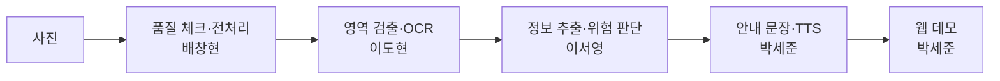
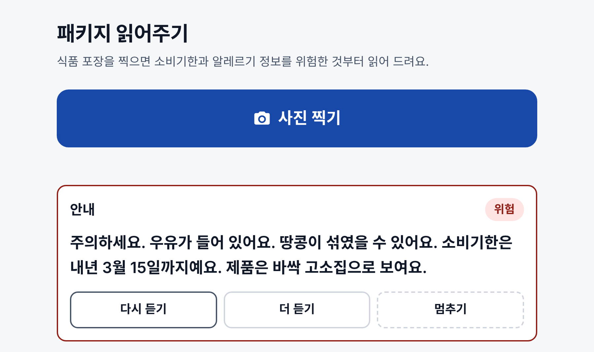
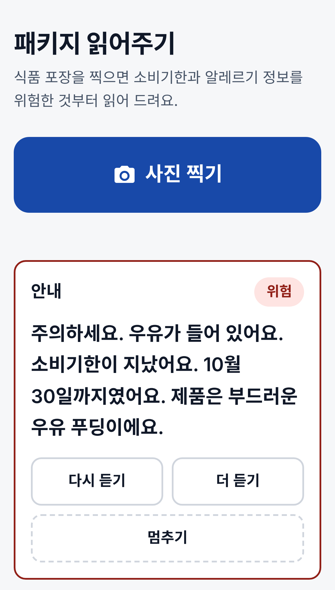
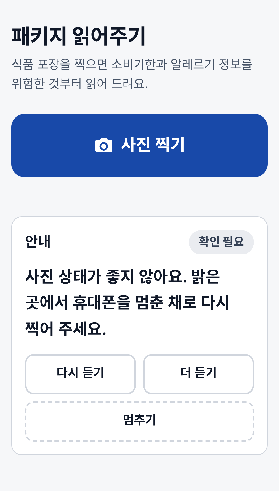
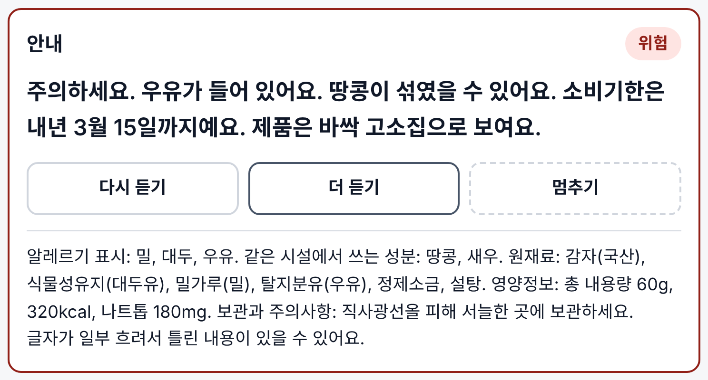
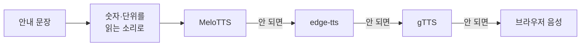
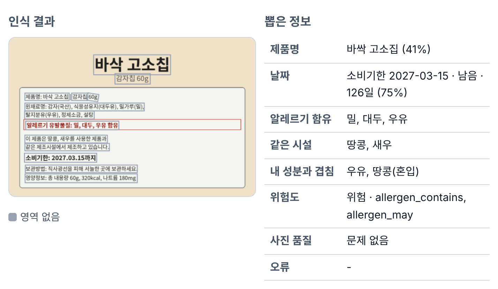

# 패키지 읽어주기 (AI_tts_web)

시각장애인을 위한 식품 포장 인식 시스템. 포장 사진에서 글자를 읽고, 소비기한과 알레르기 성분을 골라 **위험한 정보부터** 음성으로 알려 준다.

2026년 2학기 딥러닝 Team05

[](https://colab.research.google.com/github/DL-2026F-Team05/AI_tts_web/blob/main/notebooks/00_setup_and_demo.ipynb)
[](https://github.com/DL-2026F-Team05/AI_tts_web/actions/workflows/tests.yml)

## 흐름



모든 단계는 결과 형식 하나(`packreader/schema.py`의 `AnalysisResult`)를 채워서 넘긴다. 약속은 [docs/interface.md](docs/interface.md).

## 폴더와 담당

| 폴더 | 내용 | 담당 |
|---|---|---|
| `packreader/preprocess/` | 품질 체크(흐림·어두움·반사), 보정 | 배창현 |
| `packreader/ocr/` | 영역 검출, OCR 엔진 (가짜·EasyOCR·PaddleOCR) | 이도현 |
| `packreader/extract/` | 제품명·소비기한·알레르기 추출, 위험 판단 | 이서영 |
| `packreader/speech/` | 안내 문장, 숫자 읽기, TTS 엔진 | 박세준 |
| `packreader/pipeline.py` | 전체 연결 | 박세준 |
| `app/` | 웹 데모 (FastAPI + 접근성 화면) | 박세준 |
| `evaluation/` | 지표 계산, 평가 실행 | 공통 |
| `tools/` | 데이터 규칙 검사, 제품 단위 분할, 샘플 생성 | 공통 |
| `tests/` | 단위·통합 테스트 | 박세준 (각 모듈 테스트는 담당자) |
| `docs/` | 계획, 인터페이스, 데이터·평가·코랩 안내 | 공통 |
| 보고서 / PPT / 발표 | | 박주윤 / 백연경 / 김세희 |

## 담당별 결과

각자 맡은 부분의 결과를 아래에 같은 형식으로 정리한다.

### 박세준 · TTS, 웹 데모, 모듈 통합·테스트

**맡은 곳**: `packreader/speech/` (안내 문장·TTS), `app/` (웹 데모), `packreader/pipeline.py` (전체 연결), `tests/`·`.github/workflows/` (테스트·CI), `notebooks/` (코랩)

| 테스트 | 실제 OCR에서 찾은 문제 | 요약 음성 길이 (S001, edge-tts) |
|:---:|:---:|:---:|
| **150개 통과** | **7개 중 5개 대응** | **18초 → 13.3초** |

- 사진 한 장에서 음성까지 한 바퀴를 연결했다. 단계 하나가 실패해도 멈추지 않고 다음으로 넘어가서, 사용자는 "다시 찍어 주세요" 같은 안내라도 듣는다.
- 위험한 정보부터 짧게 말하는 안내 문장과, 숫자·단위를 읽는 소리대로 바꾸는 TTS를 만들었다.
- 시각장애인이 쓰는 것을 전제로 웹 데모를 만들었다. 큰 촬영 버튼, 다시 듣기·더 듣기·멈추기, 말하기 속도, 스크린리더 모드, 내 알레르기 등록이 있다.
- 실제 EasyOCR를 붙여 끝까지 돌려 보고 위험 놓침을 찾아 고친 뒤, 테스트와 GitHub Actions로 고정했다.

#### 화면

내 알레르기를 우유·땅콩으로 등록하고 합성 샘플을 넣은 화면이다. 글자 인식에는 코랩에서 EasyOCR가 실제로 읽은 결과(`tests/fixtures/easyocr_samples.json`)를 넣었다.

<p align="center">
  
  <br><sub>PC · 과자: 내 알레르기(우유)가 들어 있고 땅콩이 섞였을 수 있어서 위험</sub>
</p>

<p align="center">
  
  &nbsp;&nbsp;
  
  <br><sub>폰 · 왼쪽: 푸딩, 소비기한이 지나서 위험 · 오른쪽: 흐린 사진, 다시 찍기 안내</sub>
</p>

#### 안내 문장: 위험한 것부터, 짧게

말하는 순서는 **다시 찍기 → 내 알레르기 함유 → 기한 지남 → 혼입 가능 → 기한 → 제품명**이다. 위험이 있으면 "주의하세요."로 시작하고, 글자가 흐려 확실하지 않은 제품명은 "~로 보여요"라고 단정하지 않는다.

실제 EasyOCR 결과로 돌렸을 때 바로 읽어 주는 말 (2026-11-09 기준):

| 샘플 | 상황 | 바로 읽어 주는 말 |
|---|---|---|
| S001 과자 | 내 알레르기 함유 + 혼입, 제품명 흐림 | 주의하세요. 우유가 들어 있어요. 땅콩이 섞였을 수 있어요. 소비기한은 내년 3월 15일까지예요. 제품은 바싹 고소집으로 보여요. |
| S002 푸딩 | 소비기한 지남 | 주의하세요. 우유가 들어 있어요. 소비기한이 지났어요. 10월 30일까지였어요. 제품은 부드러운 우유 푸딩이에요. |
| S003 두유 | 날짜가 다른 면에 있음 | 땅콩이 섞였을 수 있어요. 소비기한은 다른 곳에 따로 찍혀 있어요. 뚜껑이나 바닥의 날짜를 찍어 주세요. 제품은 듣튼 두유로 보여요. |
| S004 흐린 사진 | 다시 찍기 | 사진 상태가 좋지 않아요. 밝은 곳에서 휴대폰을 멈춘 채로 다시 찍어 주세요. |
| S005 점 글씨 날짜 | 점을 이어 붙여 다시 읽음 | 표시된 날짜는 12월 24일이에요. 알레르기 표시를 찾지 못했어요. |
| S006 우유 | 유통기한 | 주의하세요. 우유가 들어 있어요. 유통기한은 11월 25일까지예요. 16일 남았어요. 제품은 신선 우유예요. |

요약은 짧게 두고 자세한 내용은 '더 듣기'로 넘겼다. 남은 날이 30일을 넘으면 날 수를 빼고 "2027년" 대신 "내년"이라고 해서, S001 요약을 18초에서 13.3초로 줄였다.

<p align="center">
  
  <br><sub>더 듣기: 알레르기 전체, 원재료, 영양정보, 보관 방법. 인식이 불확실하면 틀릴 수 있다고 덧붙인다 ('나트톱'처럼 남은 오인식도 그대로 보인다)</sub>
</p>

#### TTS: 숫자는 읽는 소리대로, 엔진이 안 돼도 소리는 나게

| 화면 글자 | TTS에 넘기는 말 |
|---|---|
| 2027년 3월 15일 | 이천이십칠년 삼월 십오일 |
| 6월 10일, 10월 30일 | 유월 십일, 시월 삼십일 |
| 60g, 320kcal, 나트륨 180mg | 육십 그램, 삼백이십 킬로칼로리, 나트륨 백팔십 밀리그램 |
| 0~10°C | 영에서 십 도 |
| 1.5L, 200mL | 일 점 오 리터, 이백 밀리리터 |



- 처음 성공한 엔진의 소리를 재생하고, 같은 문장·같은 속도는 파일로 저장해 두었다가 다시 쓴다. 엔진 순서는 `PACK_TTS`로 바꾸고 MMS도 넣을 수 있다.
- 실패한 엔진은 5분 동안 건너뛴다. 인터넷이 끊겨도 매번 기다리지 않고 바로 다음 엔진으로 간다.
- 스크린리더 모드에서는 음성을 따로 틀지 않고, 쓰던 스크린리더가 안내를 읽게 한다.

#### 통합 테스트: 실제 OCR을 붙여 보니

<p align="center">
  
  <br><sub>개발자 보기: 회색 박스가 EasyOCR가 실제로 읽은 위치, 오른쪽이 거기서 뽑은 정보다</sub>
</p>

- 가짜 OCR(정답을 그대로 돌려줌)로는 다 맞았는데, 코랩에서 실제 EasyOCR를 붙이자 문제 7가지가 드러났다. 가장 큰 건 혼입 문구의 조사를 잘못 읽어("땅콩, 새우**틀** 사용한 제품과") **땅콩 혼입 경고가 빠지는 위험 놓침**이었다.
- 통합하면서 5가지는 바로 고치거나 피해 가게 했다. 조사를 잘못 읽어도 혼입 성분 찾기, 쪼개진 줄 합치기, 숫자 옆 O·l을 0·1로 고치기, 신뢰도 낮은 제품명은 "~로 보여요", 점 글씨 날짜는 점을 이어 붙여 다시 읽기("2026.12.24"를 읽음)다.
- EasyOCR 출력 원본으로 회귀 테스트(`tests/test_real_ocr.py`)를 만들어서, 고치다가 다시 깨뜨리면 테스트가 실패한다. 남은 문제(기호 오인식, CPU에서 한 장 15~22초)와 담당은 [docs/ocr_findings.md](docs/ocr_findings.md)에 적었다.
- 테스트는 150개가 통과한다. 이서영 담당 추출 규칙 6개는 명세만 먼저 써 둔 상태(xfail)다. main에 올리거나 PR을 열면 GitHub Actions가 자동으로 돌린다.

#### 남은 일

- [ ] **TTS 엔진 비교 실험**: `notebooks/01_tts_compare.ipynb`로 MeloTTS·MMS·edge-tts·gTTS의 속도와 듣기 점수(5점)를 비교한다. 지금까지는 edge-tts로 길이만 쟀다.
- [ ] **사용자 테스트**: 요약 13초가 적당한지, 말하는 순서가 알아듣기 쉬운지 확인한다.
- [ ] **팀원 모듈 붙이기**: 영역 검출 모델과 추출 규칙이 들어오면 연결하고 다시 테스트한다.
- [ ] **시연 준비**: 코랩 T4 GPU에서 실제 EasyOCR 속도를 재고, 폰으로 리허설한다.

## 빠르게 실행

### 코랩
위 배지로 `notebooks/00_setup_and_demo.ipynb`를 열고 위에서부터 실행한다. 자세한 건 [docs/colab_guide.md](docs/colab_guide.md).

### 내 컴퓨터
윈도우는 `run_local.bat` 더블클릭: 가상환경 만들기 → 설치 → 테스트 → 웹 데모까지 한 번에 하고 브라우저를 연다.

직접 하려면:
```bash
pip install -r requirements.txt -r requirements-dev.txt
python -m pytest -q                       # 테스트
uvicorn app.main:app --port 8000          # 웹 데모 → http://localhost:8000
```

```python
from packreader.pipeline import Pipeline
print(Pipeline().analyze("data/samples/S001.jpg").speech.summary)
```

엔진은 환경 변수로 바꾼다.

| 변수 | 값 | 기본 |
|---|---|---|
| `PACK_OCR` | `dummy`, `easyocr`, `paddle` | `dummy` |
| `PACK_DETECTOR` / `PACK_DETECTOR_WEIGHTS` | `none`, `yolo` / 가중치 경로 | `none` |
| `PACK_TTS` | 쉼표로 순서: `melo,edge,gtts,mms`, `none` | `melo,edge,gtts` |

## 지금 들어 있는 것

| 모듈 | 들어 있는 것 | 다음 할 일 |
|---|---|---|
| 전처리 | 선명도·밝기·반사 판정, 어두울 때 CLAHE, 점 글씨 날짜 점 이어 붙이기(OCR 재시도) | 실제 데이터로 기준값 조정, 보정 방법 추가 |
| OCR | 가짜 OCR(합성 샘플 정답), EasyOCR·PaddleOCR 래퍼, YOLO 검출기 자리, 같은 줄 박스 합치기, 숫자 O·l 오인식 고치기 | 기준 성능 측정, 영역 검출 학습, 파인튜닝 |
| 추출 | 날짜 4가지 형식, 표시 대상 19종 사전, 함유/혼입 구분, 판단 보류 | `tests/test_extract_spec.py`의 xfail 항목 |
| 안내·TTS | 위험 우선 문장, 숫자·단위 읽기, 엔진 순서 시도·캐시, 브라우저 음성 대체 | 코랩에서 엔진 비교 실험, 사용자 테스트 |
| 웹 데모 | 촬영·업로드, 샘플, 알레르기 등록, 다시 듣기·더 듣기, 스크린리더 모드, 개발자 보기 | 실제 엔진 연결 후 폰 시연 |
| 평가 | CER·WER·검출 F1·항목별 F1·위험 놓침률·보류율·조건별 표 | 테스트셋 라벨이 모이면 실행 |

`data/samples/`의 사진 6장은 지어낸 제품으로 만든 합성 샘플이다. 모델 없이도 사진에서 음성까지 한 바퀴를 확인하는 데 쓴다.

## 문서

- [docs/plan.md](docs/plan.md): 역할, 주차별 일정, 산출물
- [docs/interface.md](docs/interface.md): 모듈끼리 주고받는 형식
- [docs/data_guide.md](docs/data_guide.md): 촬영 규칙, 파일 이름, 정답표
- [docs/eval_protocol.md](docs/eval_protocol.md): 평가 지표와 방법
- [docs/ocr_findings.md](docs/ocr_findings.md): 실제 EasyOCR로 확인한 문제와 대응 (위험 놓침 사례 포함)
- [docs/colab_guide.md](docs/colab_guide.md): 코랩에서 개발하기
- [CONTRIBUTING.md](CONTRIBUTING.md): 브랜치와 PR 규칙
